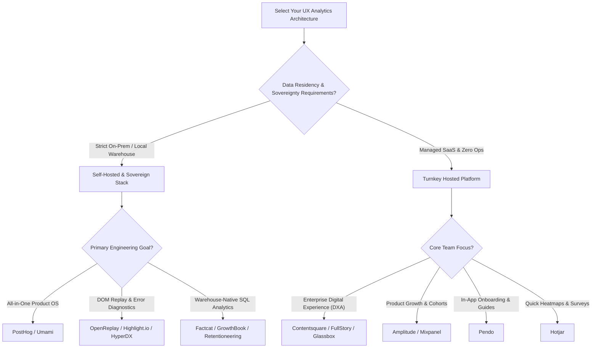

# 📊 Awesome User Experience Analytics

  

### The Definitive Curated Guide to Digital Experience Analytics (DXA), Session Replay, Product Telemetry, Click Heatmaps & Behavioral Intelligence

  
  
  
  
  
  
  

  <strong>A high-intent index for Product Managers, UX Researchers, Growth Hackers, and Software Engineers.</strong> 
  <em>Covering enterprise SaaS platforms and self-hosted, privacy-first open-source analytics engines.</em>

---

## 📑 Table of Contents

- [🔍 Overview & SEO Highlights](#-overview--seo-highlights)
- [📈 Sector Overview & Market Dynamics](#-sector-overview--market-dynamics)
- [🏢 SaaS & Hosted Enterprise Platforms](#-saas--hosted-enterprise-platforms)
- [💻 Open-Source GitHub Projects](#-open-source-github-projects)
- [🛠️ Commercial Self-Hosted Solutions](#️-commercial-self-hosted-solutions)
- [💡 Architectural Archetypes & Selection Guide](#-architectural-archetypes--selection-guide)
- [🤝 How to Contribute](#-how-to-contribute)
- [⭐ Star History](#-star-history)
- [💖 Support & Sponsoring](#-support--sponsoring)
- [⚖️ Disclaimer](#️-disclaimer)

---

## 🔍 Overview & SEO Highlights

**User Experience Analytics (UX Analytics)** and **Digital Experience Analytics (DXA)** encompass the telemetry, tooling, and behavioral methodologies used to capture, visualize, and optimize end-user journeys across web, mobile, and desktop applications.

Key technologies cataloged in this repository include:
- 🎥 **DOM Session Replay & Visual Reconstruction**: Pixel-accurate reconstruction of user interactions, mouse trajectories, mobile taps, and form inputs.
- 🔥 **Heatmaps & Attention Maps**: Click, hover, scroll depth, and zone-based aggregate interaction density maps.
- 📉 **Conversion Funnels & Drop-Off Analysis**: Multi-step conversion pipelines, rage-click and dead-click detection, and path analysis.
- 👥 **Behavioral Cohorting & Retention Analysis**: Grouping users by discrete interaction sequences to measure stickiness and feature adoption.
- 🛡️ **Privacy-First & Sovereign Telemetry**: Anonymized, cookieless, GDPR/CCPA-compliant architectures that run entirely on self-hosted Docker clusters or inside your own cloud data warehouse.

---

## 📈 Sector Overview & Market Dynamics

The global **Customer & Digital Experience Analytics (DXA)** market is valued at approximately **$15.5 Billion to $16.5 Billion in 2026**, expanding rapidly at a compound annual growth rate (**CAGR**) of **14.5%** and projected to exceed **$55 Billion** by the mid-2030s.

The sector is **moderately fragmented with active consolidation among legacy point tools**. While enterprise conglomerates (e.g., Contentsquare acquiring Heap and Hotjar, Cisco acquiring Smartlook, and ServiceNow embedding UX telemetry into the Now Platform) dominate unified enterprise suites, it is **not a winner-take-all market**: product-led growth (PLG) platforms (such as Amplitude and Mixpanel) and sovereign, self-hostable open-source frameworks (such as PostHog, OpenReplay, and Umami) command massive adoption among privacy-conscious, developer-first, and regulatory-sensitive engineering organizations.

---

## 🏢 SaaS & Hosted Enterprise Platforms

The table below lists the market-leading SaaS Digital Experience and Product Analytics platforms. It is sorted in **descending order by company size** (market capitalization, latest private valuation, or acquisition valuation).

| 🏢 Platform | 🏛️ Company Size (Valuation / Revenue) | 💰 Pricing (Starting Paid Tier) | 🎁 Free Tier Limit / Free Trial Specification | ⚙️ Primary UX Focus |
|:---|:---|:---|:---|:---|
| **[ServiceNow User Experience Analytics](https://www.servicenow.com/)** | **~$195.0B Market Cap** (NYSE: NOW) <em>~$10.5B Annual Revenue</em> | **~$100/user/month** *(Enterprise platform bundles typically start at ~$10,000/year minimum via ITSM / App Engine)* | **Free Personal Developer Instance (PDI)** with full platform analytics access *(hibernates after 10 days of inactivity; reclaimed if untouched for 14 days)* | Enterprise customer & employee portal UX monitoring, Next Experience telemetry, and journey drop-off mapping. |
| **[Contentsquare](https://contentsquare.com/)** | **$5.6B Valuation** (Series F) <em>~$300M+ ARR</em> | **$39/month** *(Growth plan; Pro & Enterprise custom contracts range from $24k–$100k+/year)* | **Free forever plan** up to **200,000 monthly sessions** & **10,000 session replays/month** *(unlimited heatmaps, 1 active project)* | Enterprise visual experience analytics, zone-based heatmaps, Sense AI struggle signals, and impact quantification. |
| **[Pendo](https://www.pendo.io/)** | **$2.6B Valuation** <em>~$150M+ ARR</em> | **~$583/month** *(Base plan billed annually at $7,000/year for up to 2,000 MAUs; mid-market median ~$49,000/year)* | **Free forever plan** up to **500 Monthly Active Users (MAUs)** *(core analytics, in-app guides, branded NPS surveys, unlimited web/mobile keys)* | Product analytics combined with in-app guidance tours, onboarding checklists, and feature adoption tracking. |
| **[FullStory](https://www.fullstory.com/)** | **$1.8B Valuation** (Series D) <em>~$100M+ ARR</em> | **~$833/month** *(Business plan starting at $10,000/year billed annually for ~50k sessions/month)* | **Free forever ("FullStoryFree")** up to **30,000 sessions/month** & **10 user seats**; or **14-day free trial** of full Business tier features | High-fidelity DOM session replay, complete autocapture, frustration signals (rage clicks, dead clicks, error clicks). |
| **[Amplitude](https://amplitude.com/)** | **~$1.4B Market Cap** (NASDAQ: AMPL) <em>~$290M+ Annual Revenue</em> | **$61/month** *(billed annually, or $75/mo billed monthly for Plus tier scaling past 2M events)* | **Free forever Starter plan** up to **2,000,000 events/month** & **10,000 session replays/month** with unlimited seats | Deep behavioral product analytics, cohort segmentation, funnel retention analysis, and integrated A/B experimentation. |
| **[Heap](https://heap.io/)** *(Contentsquare)* | **$1.4B Acquisition Value** <em>~$60M+ ARR</em> | **~$300/month** *(Growth plan billed annually at $3,600/year; enterprise custom tiers from $20k+/year)* | **Free forever plan** up to **10,000 monthly sessions**, 6 months data history, and unlimited enrichment sources | Complete retroactive autocapture (analyze past interactions without prior instrumentation), user journeys, and funnels. |
| **[Mixpanel](https://mixpanel.com/)** | **$1.05B Valuation** (Series C) <em>~$100M+ ARR</em> | **$20/month** *(billed annually, or $28/mo billed monthly for Growth tier up to 1M events; 2M events at $185/mo)* | **Free forever plan** up to **1,000,000 events/month** & **10,000 session replays/month** with unlimited seats | Event-based product analytics, interactive conversion funnels, retention matrices, and real-time behavioral segmentation. |
| **[Hotjar](https://www.hotjar.com/)** *(Contentsquare)* | **~$450M Acquisition Value** <em>~$50M+ ARR</em> | **$39/month** *(Plus plan billed annually at $468/year, or $48/mo monthly for 100 daily sessions / 3,000 sessions/mo)* | **Free forever Basic plan** up to **35 daily sessions (1,050 sessions/month)** with unlimited heatmaps and 3 active feedback surveys | Rapid visual click & scroll heatmaps, visitor session recordings, on-site user feedback widgets, and micro-surveys. |
| **[LogRocket](https://logrocket.com/)** | **~$350M Valuation** ($52M raised) <em>~$30M+ ARR</em> | **$69/month** *(Team plan billed annually for 10,000 sessions/month; Professional starts at $295/month)* | **Free forever plan** up to **1,000 sessions/month**, 1-month data retention, and 3 user seats | Frontend performance monitoring pairing visual session replay with browser console logs, network payloads, and Redux actions. |
| **[Glassbox](https://www.glassbox.com/)** | **~$150M Acquisition Value** (Alicia Tech) <em>~$50M Annual Revenue</em> | **~$1,667/month** *(Enterprise annual contract starting at ~$20,000/year for pre-agreed session packages)* | **30-day enterprise Proof-of-Concept (POC) / trial** upon sales qualification *(includes technical scoping and PII data masking)* | 100% session capture, automated struggle score algorithms, AI anomaly detection, and strict financial/healthcare compliance. |

---

## 💻 Open-Source GitHub Projects

The following active open-source projects provide self-hosted alternatives for session recording, click tracking, funnel analysis, and behavioral telemetry.

The list is sorted in **descending order by GitHub Stars_Count**. Each badge displays the live Stars_Count and links directly to the project's stargazers page.

1. **[PostHog](https://github.com/PostHog/posthog)**   
   The flagship open-source Product Operating System and UX analytics engine (MIT Core). Combines event autocapture, high-fidelity DOM session replay, click heatmaps, user journey funnels, retention tables, feature flags, multivariate A/B testing, in-app surveys, and data warehouse exports in a single deployable stack. Self-hostable via Docker/Kubernetes or available as managed cloud.

2. **[Umami](https://github.com/umami-software/umami)**   
   Modern, privacy-first web and product analytics platform (MIT). Tracks page navigation, custom event interactions, marketing campaigns, conversion funnels, and retention without cookies or fingerprinting. Features a clean, fast dashboard and minimal database overhead (PostgreSQL or MySQL).

3. **[Plausible Analytics](https://github.com/plausible/analytics)**   
   Lightweight, open-source, privacy-focused analytics (AGPL-3.0). Script is under 1KB and fully cookieless, tracking user flow, page views, bounce rates, and custom goal conversions while maintaining 100% GDPR, CCPA, and PECR compliance out of the box.

4. **[OpenObserve](https://github.com/openobserve/openobserve)**   
   High-performance, cloud-native observability platform written in Rust (AGPL-3.0). Unifies browser and mobile session replays, Real User Monitoring (RUM for web, iOS, Android), logs, metrics, and traces with up to 140x lower storage costs than traditional APM vendors.

5. **[Matomo](https://github.com/matomo-org/matomo)**   
   The mature, self-hosted web analytics platform (GPL-3.0) and leading sovereign alternative to Google Analytics. Offers rich user experience add-ons including mouse tracking heatmaps, full session recording, form field analytics, conversion funnels, and visitor profile histories.

6. **[rrweb](https://github.com/rrweb-io/rrweb)**   
   The foundational JavaScript library (MIT) powering modern open-source session replays. Encodes, serializes, and replays complete DOM mutations, CSS stylesheets, mouse moves, scroll offsets, form inputs, and canvas animations with low runtime overhead.

7. **[OpenReplay](https://github.com/openreplay/openreplay)**   
   Developer-centric, self-hosted session replay and UX debugging platform (AGPL-3.0). Reconstructs user interactions with synchronized browser DevTools (network requests, console logs, Redux/Vuex state mutations, CPU/memory spikes), click heatmaps, and funnel conversion tracking.

8. **[HyperDX](https://github.com/hyperdxio/hyperdx)**   
   Open-source observability and session playback platform (MIT) built on ClickHouse and OpenTelemetry. Seamlessly links frontend user replays with distributed backend traces, container logs, and error stack traces to diagnose UX regressions end-to-end.

9. **[Highlight.io](https://github.com/highlight/highlight)**   
   Fullstack monitoring platform (Apache-2.0) that pairs full session replay with frontend JavaScript exception tracking, backend traces, and logging. Enables developers to reproduce user bugs in seconds with integrated DevTools inspection.

10. **[GrowthBook](https://github.com/growthbook/growthbook)**   
    Warehouse-native feature flagging and experimentation engine (MIT). Connects directly to Snowflake, BigQuery, ClickHouse, or Postgres to calculate user experience experiment impact, Bayesian/frequentist statistics, and behavioral metric improvements.

11. **[OpenPanel](https://github.com/Openpanel-dev/openpanel)**   
    Modern, open-source alternative to Mixpanel and Amplitude (AGPL-3.0). Features an intuitive user dashboard for tracking custom telemetry events, user journey flows, multi-step conversion funnels, and demographic profiles with self-hosting support.

12. **[Countly](https://github.com/Countly/countly-server)**   
    Enterprise-grade, privacy-first analytics and user engagement platform (AGPL-3.0 core). Tracks granular user interactions, friction points, crash analytics, and push engagement across web, iOS, Android, and connected IoT devices.

13. **[Ackee](https://github.com/electerious/Ackee)**   
    Minimalist, privacy-first Node.js analytics server (MIT). Provides real-time traffic telemetry, page dwell duration, bounce statistics, and referral insights through a clean, distraction-free interface without user tracking or cookies.

14. **[Talivia](https://github.com/talivia-group/talivia)**   
    Revenue-first open-source analytics platform (AGPL-3.0) for startups and SaaS founders. Integrates web interaction tracking, session replay, customer journeys, and payment gateway revenue attribution.

15. **[Aptabase](https://github.com/aptabase/aptabase)**   
    Lightweight, privacy-first open-source telemetry engine (AGPL-3.0) engineered specifically for mobile (iOS, Android, Flutter, React Native) and desktop applications (Electron, Tauri). Sub-centisecond tracking with zero personal data collection.

16. **[Trench](https://github.com/FrigadeHQ/trench)**   
    High-throughput event tracking infrastructure (Apache-2.0) packaged as a single Docker image built on ClickHouse, Kafka, and Node.js. Ingests tens of thousands of client-side interaction events per second for custom UX analytics dashboards and LLM agent telemetry.

17. **[Retentioneering](https://github.com/retentioneering/retentioneering-tools)**   
    Python framework and MCP server (MIT) for quantitative UX trajectory modeling. Converts raw clickstreams into directed graph user flows, Markov chain navigation simulations, friction clustering, and conversion drop-off discovery.

18. **[smolanalytics](https://github.com/Arjun0606/smolanalytics)**   
    Single-binary analytics toolkit (MIT) combining product analytics (funnels, retention, paths), feature flags, click heatmaps, in-product surveys, and a session inspector; includes an embedded Model Context Protocol (MCP) server for querying user insights directly from code editors.

19. **[Factcat](https://github.com/gordonkjlee/factcat)**   
    Warehouse-native open-source alternative to Amplitude and Mixpanel. Generates optimized SQL queries directly against your data warehouse (BigQuery, Snowflake, DuckDB, Postgres, ClickHouse) without copying or ingesting proprietary telemetry data into an external cloud.

---

## 🛠️ Commercial Self-Hosted Solutions

For teams requiring private-cloud infrastructure with proprietary turnkey enterprise features:

- 💻 **[UXWizz](https://www.uxwizz.com/)** — Self-hosted website analytics and session recording platform with lightweight DOM capture, click/scroll heatmaps, visitor segmentation, and basic A/B testing. Perpetual license model (Personal: $299 one-time; Company: $799 one-time).
- 🔍 **[UXlens](https://uxlens.com/)** — Developer-centric session recording tool emphasizing UI conversion funnels, privacy-by-default input masking, and turnkey Docker deployment.

---

## 💡 Architectural Archetypes & Selection Guide

### Recommended Stacks by Stage:
- 🚀 **Early-Stage Startup (< 50k MAU)**: Mixpanel (Free 1M events) or PostHog Cloud (Free 1M events) + Hotjar Basic for instant visual heatmaps.
- 🏢 **Scale-Up & Mid-Market**: Amplitude Plus or FullStory Business paired with GrowthBook for feature-flagged experimentation.
- 🛡️ **Privacy-Centric & Sovereign Enterprise**: Self-hosted PostHog or OpenReplay on internal Kubernetes clusters backed by ClickHouse for zero third-party data transmission.

---

## 🤝 How to Contribute

Contributions to this ecosystem catalog are warmly welcomed! 

1. 🍴 **Fork the repository** on GitHub.
2. 🌿 **Create a descriptive branch**: `git checkout -b feature/add-new-ux-tool`.
3. 📝 **Add or update entries**: Follow the established tabular format for SaaS tools or star-badged format for open-source repositories.
4. ✅ **Ensure factual accuracy**: Verify pricing tiers, free tier caps, and GitHub repository links.
5. 🚀 **Submit a Pull Request** with a concise description of your additions.

---

## ⭐ Star History

---

## 💖 Support & Sponsoring

Thank you for visiting and supporting **Awesome User Experience Analytics**! 🌟

If you or your team found this curated directory helpful:
- ⭐ **Star this repository** on GitHub to help boost its visibility.
- 🍴 **Fork it** to bookmark or adapt for your internal tech stack.
- 📢 **Share it** on LinkedIn, X/Twitter, Discord, and Reddit with fellow product managers and engineers.
- ☕ **Sponsor the Maintainer**: If you would like to support continuous curation and maintenance, consider buying a coffee through the [GitHub Sponsor Dashboard](https://github.com/sponsors/ishandutta2007).

---

## ⚖️ Disclaimer

- This repository is a community-curated educational index and does not represent an endorsement of any listed tool or platform.
- **Privacy Compliance**: All organizations capturing user session data, heatmaps, or behavioral event logs must adhere to relevant data protection statutes (including GDPR, CCPA/CPRA, and HIPAA) and enforce PII masking for sensitive form inputs.
- **Licensing**: Verify the open-source or commercial license terms before deploying tools in enterprise environments (e.g., PostHog and Matomo maintain separate enterprise modules; OpenReplay core is licensed under AGPL-3.0).

---

  Curated with ❤️ for the global product, UX research, and software engineering community.

